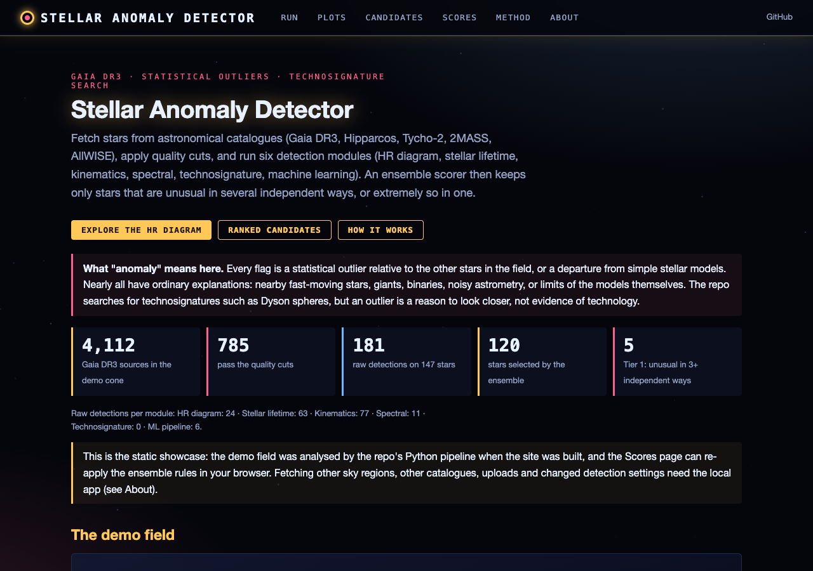
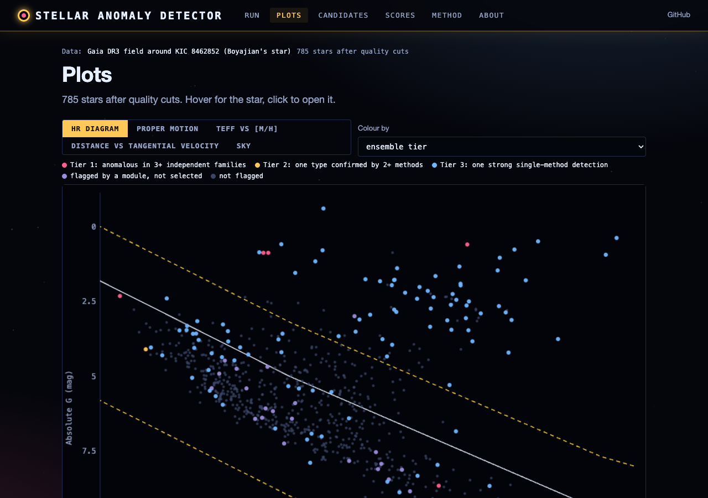
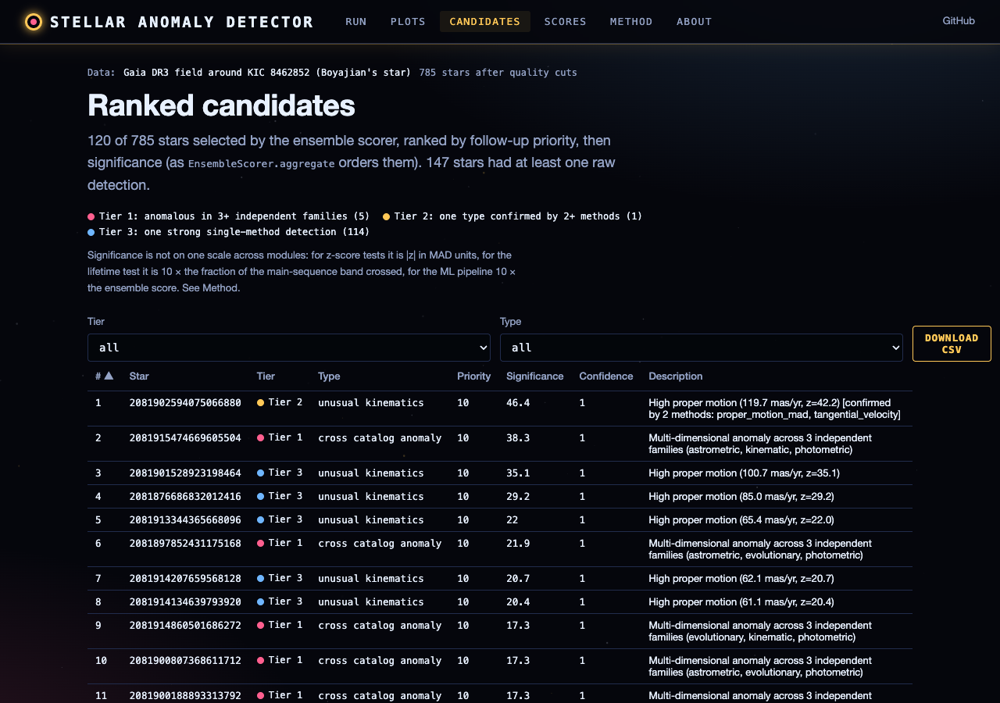
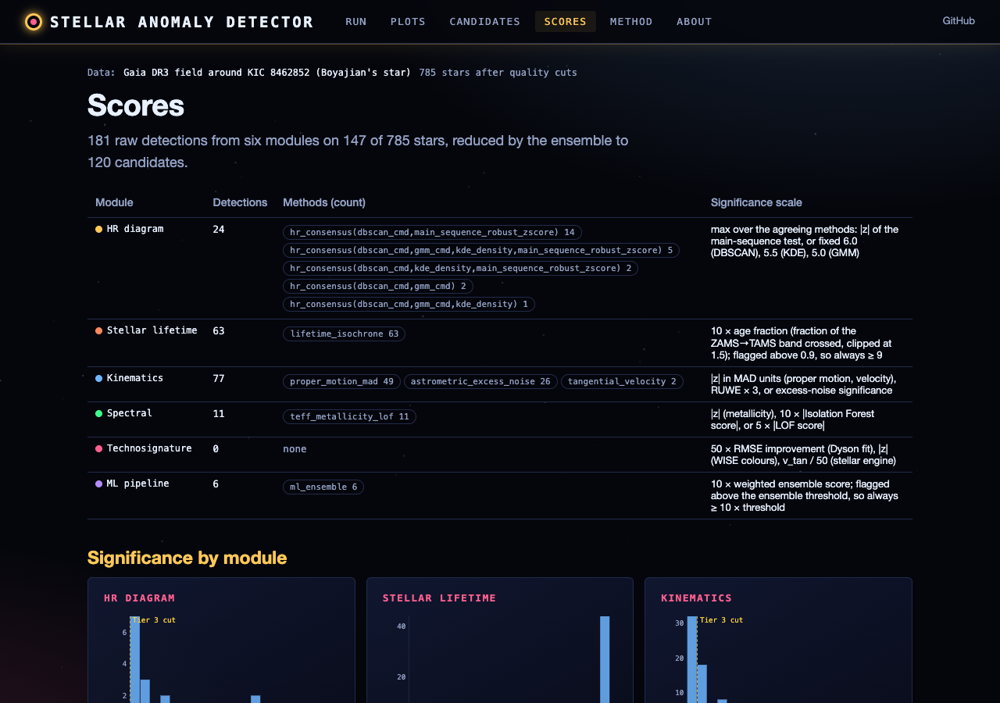

# Stellar Anomaly Detector

Advanced stellar anomaly detector and technosignature search engine. Analyzes multi-catalog astronomical survey data using ensemble machine learning, statistical methods, and astrophysical models to identify unusual stars -- including potential Dyson sphere candidates.

## Description

Stellar Anomaly Detector is a modular Python package that fetches data from major astronomical catalogs (Gaia DR3, Hipparcos, Tycho-2, 2MASS, AllWISE), applies quality filtering and preprocessing, then runs eight independent anomaly detection modules. Results are aggregated through an ensemble scorer that deduplicates and merges multi-method detections. The package includes both a CLI and a full PySide6 GUI with interactive HR diagrams, 3D galactic maps, sky projections, and light curve viewers.

## Features

### Data Acquisition
- Fetch from 5+ astronomical catalogs via astroquery (Gaia DR3, Hipparcos, Tycho-2, 2MASS, AllWISE)
- Cross-catalog matching with epoch propagation and Mahalanobis distance scoring
- Synthetic data generation with injected anomalies for testing
- Gaia DR3 quality filters (RUWE, parallax SNR, BP-RP excess factor)

### Anomaly Detection (8 Modules)
- **HR Diagram** -- Main-sequence deviation, DBSCAN noise detection, KDE low-density, GMM
- **Stellar Lifetime** -- Flags stars near end of expected main-sequence lifetime
- **Kinematics** -- Proper motion outliers, RUWE anomalies, hypervelocity candidates
- **Variability** -- Photometric scatter, Stetson J/K/L indices, Lomb-Scargle periodograms
- **Spectral** -- Metallicity outliers, chemical ratio anomalies, autoencoder ensemble
- **Technosignature** -- Dyson sphere SED grid search (Project Hephaistos methodology), IR excess, stellar engines
- **ML Pipeline** -- Isolation Forest, LOF, One-Class SVM, Adaptive IF ensemble
- **Ensemble Scorer** -- Deduplication, multi-method confidence merging

### Advanced ML
- XGBoost chemical peculiar star classification
- t-SNE and UMAP dimensionality reduction
- SHAP-based anomaly explanation
- 10-model autoencoder ensemble for spectral anomalies
- SQLite/DuckDB result persistence

### Visualization
- Interactive HR diagram with zoom, hover, click-to-select (pyqtgraph)
- 3D galactic coordinate scatter plot
- Sky projections (Mollweide, Aitoff, Hammer, Lambert)
- Light curve viewer with Lomb-Scargle and phase folding
- Publication-ready matplotlib dashboards

### GUI (PySide6)
- Dockable panel layout with dark/light themes (Catppuccin)
- Catalog browser, data table, property inspector
- Analysis configuration with presets
- Job manager with progress tracking
- Session save/restore and annotation system

## Installation

```bash
# Core dependencies
pip install numpy pandas scipy matplotlib astropy astroquery scikit-learn xgboost PySide6 pyqtgraph

# Or install as a package
pip install -e .

# With advanced ML dependencies
pip install -e ".[advanced]"
```

Requires Python 3.10+.

## Usage

### Command Line

```bash
# Analyze synthetic data (quick test)
python -m stellar_detector.cli --source synthetic --stars 2000

# Fetch and analyze Gaia DR3 data
python -m stellar_detector.cli --source gaia --stars 5000

# Multi-catalog analysis with HTML report
python -m stellar_detector.cli --multi gaia,hipparcos --stars 1000 --report

# Launch the GUI
python -m stellar_detector.cli --gui
```

### Python API

```python
from stellar_detector.data.fetcher import DataFetcher
from stellar_detector.data.preprocessing import preprocess_catalog
from stellar_detector.analysis.ensemble import EnsembleScorer
from stellar_detector.analysis.hr_diagram import HRDiagramAnalyzer
from stellar_detector.core.models import DetectionConfig

config = DetectionConfig()
fetcher = DataFetcher()
df = fetcher.fetch("synthetic", n_stars=2000)
df = preprocess_catalog(df, config)

analyzer = HRDiagramAnalyzer(config)
results = analyzer.analyze(df)
```

## Project Structure

```
stellar_anomaly_detector/
├── pyproject.toml
├── stellar_detector/
│   ├── cli.py                    # CLI entry point
│   ├── core/
│   │   ├── models.py             # AnomalyType, AnomalyResult, DetectionConfig
│   │   └── constants.py          # Physical constants, thresholds
│   ├── data/
│   │   ├── fetcher.py            # Multi-catalog data fetching
│   │   ├── preprocessing.py      # Quality filters, derived quantities
│   │   └── cross_match.py        # Cross-catalog matching
│   ├── analysis/
│   │   ├── hr_diagram.py         # HR diagram outlier detection
│   │   ├── stellar_lifetime.py   # Lifetime anomaly detection
│   │   ├── kinematics.py         # Kinematic anomalies
│   │   ├── variability.py        # Photometric variability analysis
│   │   ├── spectral.py           # Chemical abundance anomalies
│   │   ├── technosignature.py    # Dyson sphere / technosignature search
│   │   ├── ml_pipeline.py        # Ensemble ML detection
│   │   ├── ensemble.py           # Result aggregation
│   │   ├── dimensionality.py     # t-SNE, UMAP, SHAP, XGBoost
│   │   └── persistence.py        # DuckDB/SQLite result storage
│   ├── models/
│   │   └── stellar_evolution.py  # Astrophysical models
│   ├── visualization/
│   │   └── plots.py              # Matplotlib figures
│   ├── gui/                      # PySide6 GUI (13 modules)
│   │   ├── main_window.py
│   │   ├── catalog_browser.py
│   │   ├── data_table.py
│   │   ├── interactive_hr.py
│   │   ├── sky_map.py
│   │   ├── galactic_3d.py
│   │   ├── light_curve_viewer.py
│   │   └── ...
│   └── utils/
│       ├── io.py                 # CSV/VOTable/FITS export, HTML reports
│       ├── session.py            # Workspace save/restore
│       ├── annotations.py        # Anomaly tagging and comments
│       └── export.py             # Publication exports (LaTeX, SVG, PDF)
├── tests/                        # Unit tests (79) + web tests (tests/test_web.py)
└── stellar_data/                 # Local data cache
```

## Web interface

A local web app and a static showcase site run the same pipeline in the browser-facing form: catalogue download,
quality cuts, the six detection modules, the ensemble scorer, and plots drawn client-side from JSON.

**Live static site:** https://gddickinson.github.io/stellar_anomaly_detector/ (published from `main` by
`.github/workflows/pages.yml`). It shows a demo field, all 4,112 Gaia DR3 sources within 0.15° of KIC 8462852
(Boyajian's star), analysed by the Python pipeline at build time; the Scores page re-applies the ensemble rules in your
browser (a JS port of `EnsembleScorer`, tested against the Python output). Fetching other regions or catalogues,
uploading a CSV and changing detection settings need the local app.

### Run the web app

```bash
pip install -r requirements-web.txt
python run_web.py                      # http://127.0.0.1:8233
python scripts/build_static.py         # static site into site/
python -m pytest -q tests/test_web.py  # web tests (no network)
```

Pages: **Run** (fetch any catalogue/sky region, upload a CSV, change thresholds), **Plots** (HR diagram with the
main-sequence model and threshold band, proper motions, Teff–[M/H], velocity, sky; click a star), **Candidates**
(ranked ensemble selection with tiers, CSV export), **Scores** (detections per module and method, significance
distributions, ensemble-rule explorer), **Star** (all detections and catalogue values for one star), **Method** and
**About**.

Every flag is a statistical outlier relative to the field or a departure from simple models; most have ordinary
astrophysical explanations. An outlier is a reason to look closer, not evidence of technology.

| | |
|---|---|
|  |  |
|  |  |

Demo data: ESA/Gaia/DPAC, Gaia DR3 (CC BY-SA 3.0 IGO); see [THIRD_PARTY.md](THIRD_PARTY.md).

## License

MIT


---
*Built with AI assistance from [Claude (Anthropic)](https://claude.com/).*
